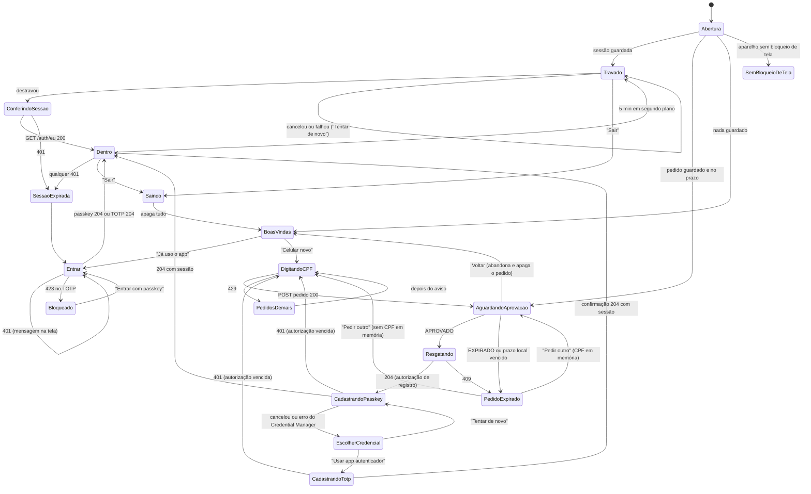

# App Android (MVP) — design

**Status:** proposta da E1, com as decisões do CEO de 12/11/2026. Aguarda a aprovação do CEO no PR.
**Objetivo:** o casal usa o Gestor Financeiro no celular por um app nativo: entra com passkey, vê a visão geral, o orçamento e as metas com os mesmos números do site e lança uma despesa em até 4 toques. Nenhum número é calculado no aparelho.

**Base:**
- `CLAUDE.md` (regras 1 a 10) e `.claude/rules/android.md`;
- ADR-006 (DuckDNS, porta 443), ADR-011 (sessão em cookie, login, celular novo, bloqueio), ADR-012 (papéis) e ADR-015 (opção B: contas ligadas ao banco não aceitam lançamento manual);
- ADR-016, escrita nesta etapa: app como cliente, origem aceita, keystore e distribuição;
- o prompt de papel do Dev Sênior Mobile e o backlog e a estratégia de testes do CEO, transcritos abaixo.

**Papéis:** o CEO é o PO desta frente. O Dev Sênior Mobile (Claude Code) implementa. A revisão cruzada é feita pela sessão Claude QA (worktree `~/Gestor-Financeiro-qa`).

## Decisões do CEO nesta etapa (12/11)

1. **Celular novo segue a ADR-011, sem mudança no servidor** (opção A). O APP-01 e o APP-02 foram reescritos (ver Backlog).
2. **"Reprovado" sai do APP-01.** O servidor não tem esse estado. A mensagem é "O pedido não foi aprovado a tempo", com "Pedir outro". Recusar no site é melhoria futura: #44.
3. **Aprovadas:**
   - o CPF fica só em memória;
   - a retomada do pedido;
   - a consulta do estado com intervalo crescente.
4. **Acréscimos à máquina de estados:**
   - todo estado com requisição tem SemConexão/ServidorFora, com "Tentar de novo", e mantém o estado de origem;
   - PedidosDemais (429) mostra o tempo de espera e volta a DigitandoCPF;
   - em Travado, um destravamento cancelado ou falho continua em Travado, com "Tentar de novo" e "Sair";
   - Voltar em AguardandoAprovação abandona o pedido.
5. **Estrutura:** um só módulo `app`, com os pacotes `ui`, `viewmodel`, `dados`, `api`, `seguranca` e `movimento`. Um teste de arquitetura (Konsist) roda dentro do `testDebugUnitTest`.
6. **Distribuição:** APK no Release do GitHub (o repositório é público).
   - Nenhum segredo, chave ou dado do casal vai no APK nem nas notas do Release.
   - R8 fica ligado no release.
   - Um APK reempacotado não usa a passkey, por causa do `assetlinks.json`.
7. **Versões e identificação:**
   - `minSdk 30` e `targetSdk 36`;
   - package `br.gestorfinanceiro.app`, e o debug com o sufixo `.debug`;
   - `versionCode = X·10000 + Y·100 + Z` para a tag `app-vX.Y.Z`;
   - cabeçalho `X-Requested-With: gestor-web` (o mesmo do site);
   - User-Agent `GestorFinanceiro-Android/<versão>`.
8. **Assinatura:** a keystore de release nunca fica nesta máquina.
   - Na **E5**, um workflow de disparo manual gera o APK assinado como artefato de curta duração, para testar a passkey real no tablet.
   - Na **E8**, a tag `app-v*` gera o APK no Release.
9. **429 sem `Retry-After`:** o app mostra um tempo de espera genérico. Mandar o cabeçalho é melhoria futura: #45.

## Abordagens consideradas

| Decisão | Opções | Escolha e por quê |
|---|---|---|
| Celular novo | **A.** Seguir a ADR-011: o celular mostra o código e o cônjuge aprova no site. **B.** Fluxo novo, com o código vindo do site e a sessão antes da credencial | **A.** O servidor não muda. B abriria uma sessão sem passkey nem TOTP no aparelho e exigiria mudar a ADR-011 |
| Estrutura do código | **A.** Um módulo com pacotes e teste de arquitetura. **B.** Vários módulos Gradle (`core:*`, `feature:*`) | **A.** São 10 histórias para um casal. Compila rápido, a lista positiva do gradle não ganha uma tarefa por módulo, e o Konsist garante a fronteira, como o `ArchitectureTests` faz no backend. O Macrobenchmark da E8 pede um módulo de teste à parte (pergunta 7) |
| Distribuição | **A.** Release do GitHub. **B.** APK servido pelo próprio servidor | **A.** É simples e não precisa de login no celular. O domínio já é público pelo site, e o APK não leva segredo |

## Backlog do MVP

Cada história fecha com todos os critérios conferidos no PR. **APP-01 e APP-02 foram reescritos** na E1 (decisão 1). O texto original fica registrado para comparação.

### APP-01 Ativar celular novo (reescrito)
*Original: "Ativar celular novo pelo código de 6 dígitos (ADR-011): código válido abre sessão e segue para cadastrar passkey; código errado conta para o bloqueio progressivo; expirado pede novo no site; nenhum campo de senha; sessão cifrada com chave do Keystore."*

1. **CPF.** A pessoa digita o CPF, com máscara e conferência dos dígitos verificadores no campo, só para avisar erro de digitação. O app manda `POST /api/v1/auth/dispositivo/pedido`.
   - *Mudou:* o celular não digita código; ele digita o CPF.
2. **Espera da aprovação.** A tela mostra:
   - o **código de 6 dígitos em tamanho grande**, lido pelo TalkBack dígito a dígito;
   - o aviso **"Peça para seu cônjuge aprovar no site"**;
   - o **tempo restante** até a validade de 10 min.
3. **Consulta do estado.** O app consulta `GET /api/v1/auth/dispositivo/pedido` em intervalo crescente: 2 s, 4 s, 8 s e depois a cada 15 s, bem abaixo do limite do Caddy (60/min por IP). Para em segundo plano e volta ao reabrir, com uma consulta imediata.
4. **Aprovado.** O app resgata a autorização de registro (`POST …/pedido/resgate`) e segue para o APP-02.
   - *Mudou:* a sessão não abre aqui. Ela só abre quando a passkey ou o TOTP é cadastrado (ADR-011).
5. **Expirado.** A mensagem é **"O pedido não foi aprovado a tempo"**, com **"Pedir outro"** ali mesmo. Com o app ainda vivo, o pedido novo usa o CPF que está em memória, sem digitar de novo.
   - *Mudou:* não existe "código errado" nem "reprovado" (decisão 2), e o pedido novo sai no próprio celular, não no site.
6. **Pedidos demais (429).** Mostra o tempo de espera e volta a DigitandoCPF. Usa o `Retry-After` quando vier; até a #45, mostra "Aguarde alguns minutos".
7. **App fechado durante a espera.** Se o pedido ainda estiver no prazo, a espera é retomada com o mesmo código e o tempo restante. Senão, recomeça do CPF.
   - O `PedidoCriadoDto` só traz o código, sem a validade. **Decisão do Dev:** o prazo local é de 10 min (`TemposDoLogin.Pedido`), contado a partir do envio pelo relógio de parede, e guardado junto com o pedido. A palavra final é sempre do servidor: um `EXPIRADO` encerra a espera antes do prazo local, e o prazo local vencido leva a PedidoExpirado sem esperar a consulta.
8. **CPF.** Não é guardado no aparelho depois de enviado. Fica só na memória do ViewModel e nunca vai para disco, `SavedStateHandle`, log ou captura.
9. **Voltar em AguardandoAprovação.** Abandona o pedido no app e apaga os dados guardados dele. No servidor, o pedido expira sozinho.
10. **Sem senha.** Nenhum campo de senha.
11. **Sessão cifrada** com chave do Keystore (ver "Sessão").

### APP-02 Cadastrar passkey (reescrito)
*Original: "Cadastrar passkey (Credential Manager + API existente): cancelar não quebra, oferece de novo em Ajustes; sem bloqueio de tela no aparelho, o app explica o que falta."*

1. Com a autorização de registro, o app pede as opções (`POST /auth/passkey/registro/opcoes`), cria a passkey pelo Credential Manager e a grava (`POST /auth/passkey/registro`). A resposta 204 traz o cookie de sessão: a pessoa está dentro.
2. **Cancelar não quebra.** A tela EscolherCredencial oferece **"Tentar de novo"** e **"Usar app autenticador (TOTP)"**.
   - O TOTP passa por `POST /auth/totp/registro` e depois `/auth/totp/confirmacao` com o primeiro código.
   - O app oferece abrir o `otpauth://` no app autenticador do próprio celular e mostra o segredo para digitar à mão. O segredo nunca vai para log nem captura.
   - *Mudou:* sem sessão, não há "Ajustes" para onde mandar a pessoa.
3. **Autorização vencida.** A autorização de registro vale 10 min e só uma vez. Se vencer (401), volta para DigitandoCPF com a mensagem "O tempo para cadastrar acabou. Peça de novo."
4. **Passkey depois, em Ajustes.** Quem entrou por TOTP vê "Cadastrar passkey" em Ajustes. O fluxo usa a autorização que o usuário logado já pode emitir (`POST /dispositivos/credenciais/autorizacao`, que pede confirmação recente pelo `/auth/confirmar`).
   - *Mudou:* "oferece de novo em Ajustes" vale para quem já tem sessão.
5. **Sem bloqueio de tela.** Se o aparelho não tem bloqueio de tela (`KeyguardManager.isDeviceSecure` falso), o app explica o que falta ("Para usar o app, ative o bloqueio de tela com PIN, padrão, senha ou digital") e abre os ajustes do sistema. **Decisão do Dev:** sem bloqueio de tela o app não segue, nem para o TOTP, porque o APP-04 depende dele.

### APP-03 Entrar no dia a dia
Passkey primeiro e TOTP como alternativa, na mesma tela. A passkey criada no site funciona no app (mesmo RP ID, ver "Servidor"). Erro de rede, servidor fora e bloqueio progressivo têm mensagens próprias:
- 423: "Conta bloqueada por tentativas erradas. Entre com a passkey ou peça ao seu cônjuge para destravar." A passkey entra mesmo com a conta bloqueada (ADR-011).
- O TOTP pede CPF e código a cada vez, porque é assim que o servidor recebe. O CPF não é guardado.

### APP-04 Destravar
- **Quando trava:**
  - depois de 5 min em segundo plano, contados por relógio monotônico (`elapsedRealtime`) entre `ON_STOP` e `ON_START`;
  - toda vez que o app abre com uma sessão guardada.
- **Como destrava:** BIOMETRIC_STRONG ou PIN/padrão (`DEVICE_CREDENTIAL`).
- **Destravou mas a sessão expirou:** com o destravamento certo, se o servidor disser que a sessão expirou, o app leva ao login.
- **Apps recentes:** o conteúdo fica escondido (FLAG_SECURE).
- **Cancelou ou falhou:** continua em Travado, com "Tentar de novo" e "Sair" (decisão 4).

### APP-05 Sair
- Encerra a sessão na API (`POST /auth/sair`) e apaga o cookie, as chaves e o estado local.
- O botão Voltar não mostra telas com valores: a pilha de navegação é zerada.
- Detalhes em "Sessão".

### APP-06 Visão geral
- Tudo vem do módulo Painel (`GET /api/v1/visao-geral`); nenhum cálculo no app. Os números são idênticos aos do site.
- **"Tudo" quer dizer as 10 seções do `VisaoGeralDto`**, com paridade com o site:
  - ainda dá para gastar, saldos e aporte planejado;
  - patrimônio e o gráfico do patrimônio em 12 meses;
  - avisos de fatura, metas, orçamento, vencimentos e últimos lançamentos.
- **O gráfico** é desenhado com Canvas próprio, sem biblioteca, como linha simples com os pontos da API (decisão do Dev). Tem descrição para o TalkBack com o primeiro e o último valor, e segue a regra da escala de animação.
- A fatura vencida fica no topo.
- Os números são animados, sem animação se a escala do sistema for 0.
- Estados: carregando, vazio, erro e sessão expirada.

### APP-07 Orçamento do mês
- Teto, usado e restante por categoria vêm da API (`GET /api/v1/orcamento`).
- "Teto atingido" e "Passou R$ X do teto" aparecem iguais ao site e saem só do `RestanteCentavos` da API: zero dá "Teto atingido" e negativo dá "Passou R$ |restante| do teto", como em `frontend/src/paginas/visao-geral/CartoesDoTopo.tsx`. É escolha de texto pelo sinal de um valor pronto, não cálculo. Sem teto (`TetoCentavos` nulo), não há barra.
- As barras são animadas.

### APP-08 Metas
- Guardado, aporte do mês e "chega em" vêm da API (`GET /api/v1/metas`).
- Sem simulador no MVP.

### APP-09 Lançamento rápido
- **Até 4 toques**, com a data de hoje preenchida.
- **Contas:** as ligadas ao banco (`ContaDto.Ligada`) e as arquivadas não aparecem (opção B da Fase 2). O servidor recusa do mesmo jeito, e o app mostra o erro dele.
- **Chave idempotente:** cada lançamento leva uma `ChaveIdempotente` gerada uma vez por rascunho. "Tentar de novo" depois de erro de rede reenvia a mesma chave, e o servidor devolve o lançamento que já existe em vez de duplicar.
- **Erros:** a API valida e o app mostra o erro dela (Problem Details).
- **Depois de lançar:** a Visão geral e o orçamento se atualizam, buscando de novo.
- **Rascunho e sessão expirada:** o rascunho sobrevive à sessão expirada só em memória (decisão do Dev). Se o sistema matar o processo, ele se perde, porque nada financeiro vai para disco.

### APP-10 Instalar e atualizar
- A tag `app-v*` gera o APK assinado no Release (E8). Na E5, um workflow manual gera um artefato de curta duração.
- Atualizar por cima mantém a passkey e a sessão: mesma chave de assinatura e `versionCode` crescente.
- Runbook com o backup da keystore, que nunca fica nesta máquina.

**Fora do MVP:** notificações, widget, offline, conciliação da Fase 2, simulador de metas, iOS, recusar pedido no site (#44) e `Retry-After` (#45).

## Arquitetura

Um só módulo Gradle `app` (decisão 5). Pacote base `br.gestorfinanceiro.app`.

```
br.gestorfinanceiro.app
├── ui/            Compose: telas, componentes, tema (ui/theme), navegação, robôs só em test/
│   └── theme/Motion.kt   tokens de movimento (único lugar com duração e curva)
├── viewmodel/     um ViewModel por tela; StateFlow<EstadoDaTela> imutável; eventos únicos por Channel
├── dados/         repositórios; traduzem o cliente gerado em resultados do app (Sucesso, SemConexao,
│                  ServidorFora, SessaoExpirada, Recusado(problem), Bloqueado, Limite(retryAfter?))
├── api/           cliente gerado do OpenAPI (openApiGenerate; nunca editado à mão) e configuração do
│                  OkHttp: CookieJar cifrado, X-Requested-With, User-Agent, timeouts
├── seguranca/     CofreDeSessao (DataStore + Tink), PasskeyGateway, DestravamentoLocal, Relogio,
│                  FLAG_SECURE, controle do travamento
└── movimento/     escala de animação do sistema (EscalaDeMovimento) e helpers de animação que leem os tokens
```

**Regras do teste de arquitetura** (Konsist, no `testDebugUnitTest`):
- **`ui`:**
  - não importa `api` nem `dados`; fala só com `viewmodel`;
  - é o único lugar com `androidx.compose.*`, fora `movimento`.
- **`viewmodel`:** não importa `api` nem `android.*`, exceto `androidx.lifecycle`.
- **`dados`:** é o único que importa `api`.
- **`api`:** o código gerado só é importado por `dados` e pela configuração do OkHttp.
- **`seguranca`:**
  - não importa `ui`;
  - só ele toca `androidx.credentials`, `androidx.biometric`, Tink e `KeyStore`.
- **Valores e tokens:**
  - nenhuma classe fora de `ui/theme` declara duração em ms ou `CubicBezierEasing`;
  - nenhum tipo `Double`/`Float` carrega valor em dinheiro: os centavos chegam como `Long` e só a formatação pt-BR os transforma em texto.

**Peças:**
- **Injeção:** Hilt.
- **Navegação:** Navigation Compose com rotas tipadas.
- **Activity:** uma só, com FLAG_SECURE na janela (vale para todas as telas, inclusive a do código).
- **Cliente gerado:** openapi-generator, gerador `kotlin` com a biblioteca `jvm-retrofit2` e kotlinx-serialization. Fica fora do controle de versão ou em pasta própria, à escolha do plano. A checagem de contrato do CI roda o `openApiGenerate` e um `git status` só nessa pasta.
- **Endereço da API:** propriedade de build `GF_API_BASE_URL`. No CI, vem de uma variável do GitHub (não é segredo, mas fica fora do repositório, como o `{$DOMINIO}` do Caddyfile).
- **Formatação:** moeda e data em pt-BR por funções puras, testadas na JVM.
- **Telas grandes:** `WindowSizeClass`. No celular (compacta), uma coluna. No tablet (média ou expandida), a Visão geral e o orçamento em duas colunas e o lançamento como painel lateral. O tablet A7 Lite é o piso de desempenho.

## Máquina de estados do login



**Regras transversais:**
- **Falhas de rede (decisão 4).** Todo estado que faz requisição (DigitandoCPF, AguardandoAprovacao, Resgatando, CadastrandoPasskey, CadastrandoTotp, Entrar, ConferindoSessao, Saindo e as telas do APP-06 a 09) tem dois subestados:
  - **SemConexão:** sem rede ou timeout;
  - **ServidorFora:** 5xx, 502/503 do Caddy ou TLS recusado.

  Os dois mostram "Tentar de novo" e mantêm o estado de origem: o código continua na tela e o rascunho continua preenchido. Na AguardandoAprovacao, a consulta automática segue tentando no mesmo ritmo e o tempo restante continua correndo.
- **Sessão expirada (APP-04).** Na ConferindoSessao, só o 401 leva a SessaoExpirada. Sem rede, o app fica em SemConexão: não deixa ver valores e não apaga a sessão.
- **Na memória da máquina:** só ids, estados e o CPF da tela de celular novo. Nunca valores.
- **Testes:** a máquina é uma classe pura no `viewmodel`, com as transições testadas na JVM (uma por seta do diagrama).

## Sessão: como é guardada e como é apagada

**O que se guarda:**

| Item | Onde | Quanto tempo |
|---|---|---|
| Cookie `__Host-gf_sessao` | DataStore, cifrado | Até sair ou até o servidor dizer 401 |
| Cookie `__Host-gf_pedido` + código + validade | DataStore, cifrado | Até o pedido sair da espera (aprovado, expirado, abandonado) |
| Cookie `__Host-gf_registro` | Só memória | Até cadastrar a credencial; se o processo morrer, recomeça do CPF |
| CPF | Só memória do ViewModel | Até sair da tela |
| Valores financeiros, rascunho do lançamento | Só memória | Nada vai para disco no MVP |

**Como se cifra:**
- Tink AEAD (AES-256-GCM), com o keyset protegido por uma chave mestra do Android Keystore (`AndroidKeysetManager`, `android-keystore://`). A chave mestra não sai do Keystore.
- Cada valor é cifrado com AAD `nome-do-item|versão`, então um valor não pode ser trocado por outro.
- **Decisão do Dev:** no MVP, a chave mestra não exige autenticação do usuário. O APP-04 protege a interface; prender a chave ao destravamento é pergunta em aberto.

**Como se envia:**
- Um `CookieJar` próprio no OkHttp devolve os três cookies só para o host de `GF_API_BASE_URL`, só por HTTPS e só no caminho `/`.
- Toda requisição leva `X-Requested-With: gestor-web` e `User-Agent: GestorFinanceiro-Android/<versionName>`.
- O `HttpLoggingInterceptor` existe só no debug, com `redactHeader("Cookie")` e `redactHeader("Set-Cookie")`.

**Como se apaga:**
- **Sair (APP-05):**
  1. `POST /auth/sair`, com o cookie;
  2. com ou sem sucesso, apaga o DataStore, o keyset do Tink e a chave mestra do Keystore;
  3. limpa o `CookieJar` em memória;
  4. chama `CredentialManager.clearCredentialState()`;
  5. reinicia a Activity com a pilha zerada.

  Se o `POST` falhar por rede, o app avisa: "Saímos deste celular. A sessão no servidor expira sozinha em até 7 dias; para encerrá-la agora, remova este aparelho no site."
- **401 em qualquer chamada autenticada:** apaga só o cookie de sessão e leva a SessaoExpirada, mantendo os rascunhos em memória.
- **Pedido abandonado, expirado ou resgatado:** apaga o cookie do pedido, o código e a validade.
- **Backup e transferência:**
  - `android:allowBackup="false"`;
  - `dataExtractionRules` excluem tudo, para backup na nuvem e transferência entre aparelhos;
  - a sessão nunca vai para outro celular.

## Servidor (E3)

**Muda:**
1. **Origem WebAuthn do app.** O `Seguranca:WebAuthn:Origens` ganha `android:apk-key-hash:<SHA-256 do certificado de release, base64url sem padding>`. O hash vem de quem guarda a keystore, não desta máquina.
   - A configuração de produção fica em `/opt` e é aplicada pela pessoa com `sudo`.
   - O teste confirma que `OpcoesDoWebAuthn.EhValida` aceita esse formato, que não é URL `https`. Se não aceitar, a validação muda para aceitar `android:apk-key-hash:` além de URLs absolutas.
   - **A origem do APK de debug nunca entra em produção.**
2. **`/.well-known/assetlinks.json` no Caddy.** Relação `delegate_permission/common.get_login_creds` para o `br.gestorfinanceiro.app`, com a impressão SHA-256 do certificado de release vinda de uma variável de ambiente, como o `{$DOMINIO}`.
   - Tem de responder 200, `Content-Type: application/json`, sem redirect e fora das zonas de limite.
   - Um APK reempacotado tem outro certificado: o Credential Manager não oferece a passkey a ele, e a origem dele não está na lista.
3. **Testes da E3:**
   - a origem web e a do app são aceitas, e uma origem estranha é recusada;
   - o `assetlinks.json` responde 200, em JSON e sem redirect.

**Não muda:**
- os endpoints, os DTOs e o contrato;
- os cookies `__Host-`, os tempos, o bloqueio progressivo e o pedido de celular novo;
- o cabeçalho anti-CSRF (o app manda `gestor-web`);
- o RP ID (o domínio do site, por isso a passkey do site serve no app);
- os limites do Caddy;
- o fato de o servidor não guardar User-Agent (ver perguntas).

**Condição para a passkey funcionar:** o Google precisa ler o `assetlinks.json` pela internet, então a porta 443 tem de estar aberta (ADR-006). Até lá, o app entra só por TOTP, e o teste de ponta a ponta da passkey espera a 443.

## Movimento

Tokens só em `ui/theme/Motion.kt`, sobre as curvas do Material 3:

| Token | Duração | Curva | Uso |
|---|---|---|---|
| `curta` | 100 ms | `standard` (0.2, 0, 0, 1) | toque, troca de cor, estado de botão |
| `media` | 250 ms | `emphasizedDecelerate` (0.05, 0.7, 0.1, 1) | entrar de componente, cartão, aviso |
| `saida` | 200 ms | `emphasizedAccelerate` (0.3, 0, 0.8, 0.15) | sair de componente |
| `tela` | 400 ms | `emphasized` (0.2, 0, 0, 1) | transição entre telas |
| `numero` | 600 ms | `emphasizedDecelerate` | números da Visão geral (APP-06) |
| `barra` | 500 ms | `emphasizedDecelerate` | barras do orçamento e das metas (APP-07, APP-08), com 40 ms de atraso entre itens, no máximo 6 escalonados |

**Regra da escala de animação:**
- **De onde vem a escala:** `movimento/EscalaDeMovimento` lê `Settings.Global.ANIMATOR_DURATION_SCALE` ao abrir e acompanha mudanças por `ContentObserver`. Tudo passa por ela, sem confiar no comportamento implícito do Compose.
- **Toda duração é `token × escala`.**
- **Escala 0** (inclui o "Remover animações" da acessibilidade):
  - sem animação decorativa;
  - número e barra aparecem no valor final;
  - transição de tela troca na hora (`snap`);
  - o indicador de carregamento continua, porque é informação, não decoração.
- **Números animados:**
  - vão do valor anterior ao novo (do zero só na primeira carga);
  - a semântica de acessibilidade tem sempre o valor final formatado, e o TalkBack não lê os intermediários;
  - a animação não muda o tamanho do texto, com algarismos tabulares, para o layout não pular.

## Versões, identificação e build

- **Versões:** `minSdk 30` (Android 11; é o mínimo em que `BIOMETRIC_STRONG or DEVICE_CREDENTIAL` funciona no mesmo prompt, e o A7 Lite já atende) e `targetSdk 36`. O JDK e o SDK seguem o `android/README.md`.
- **Package:** `applicationId br.gestorfinanceiro.app`. O debug usa `br.gestorfinanceiro.app.debug`, que pode ficar instalado lado a lado e não tem passkey em produção.
- **Versão do APK:**
  - a tag `app-vX.Y.Z` define `versionName X.Y.Z` e `versionCode X·10000 + Y·100 + Z`;
  - Y e Z ficam entre 0 e 99;
  - o CI recusa tag fora do padrão ou com `versionCode` que não cresce.
- **Release:**
  - R8 ligado (`isMinifyEnabled` e `isShrinkResources`), com regras para o kotlinx-serialization e os modelos gerados;
  - sem `debuggable`;
  - `network_security_config` sem cleartext.
- **Debug:**
  - aponta para a pilha local de desenvolvimento (`GF_API_BASE_URL` de debug);
  - aceita só a CA de desenvolvimento do Caddy local (`tls internal`), por `network_security_config` exclusivo do debug, porque os cookies `__Host-` exigem HTTPS;
  - nunca aponta para o servidor de verdade (dados reais).
- **No APK e nas notas do Release:** nenhum segredo, chave ou dado do casal. As notas listam só as mudanças, sem nomes, valores ou capturas com dados.

## Estratégia de testes

Transcrita do CEO:
- **Unidade (JVM):** ViewModels, repositórios, formatação pt-BR, erros da API e máquina de estados do login. JUnit + coroutines-test + Turbine.
- **HTTP (JVM):** cliente gerado + repositório, com MockWebServer e fixtures do contrato (200, 401, 409, 429, sessão expirada, cookie).
- **Contrato (CI):** `openApiGenerate` + `git diff` só na pasta do cliente gerado.
- **Interface (JVM):** padrão Robot com Compose UI Test + Robolectric. Cada tela nova vem com o robô dela.
- **Captura (JVM):** Roborazzi em celular e tablet, claro e escuro, fonte grande e animação desligada.
- **Instrumentado:** `connectedDebugAndroidTest` no emulador `gf-pixel-api36` e no tablet A7 Lite (Keystore real, FLAG_SECURE, PIN).
- **Servidor (E3):** origem web e do app aceitas, origem estranha recusada; `assetlinks.json` com 200, JSON e sem redirect.
- **Desempenho (E8):** Macrobenchmark de início frio e rolagem no tablet.
- **Manual:** passkey de ponta a ponta, celular novo, TalkBack e escala de fonte (sessão Claude QA).
- **Regras:**
  - PasskeyGateway e DestravamentoLocal ficam atrás de interfaces, com versões falsas nos testes;
  - nenhum dado real em fixture, captura ou log;
  - Kover com meta de 80% em ViewModel e repositório;
  - teste vermelho bloqueia o merge.

**Detalhes do Dev:**

| Camada | O que se testa | Como |
|---|---|---|
| `viewmodel` | Máquina de estados (uma transição por seta), estados de tela, eventos únicos, ritmo da consulta (2, 4, 8, 15 s), travamento aos 5 min | `Relogio` falso e `TestDispatcher` com tempo virtual; Turbine no `StateFlow` |
| `dados` | Tradução de cada resposta em resultado do app: 200, 204 com `Set-Cookie`, 401, 409, 423, 429 com e sem `Retry-After`, 5xx, timeout e Problem Details | MockWebServer com fixtures JSON geradas a partir de exemplos do contrato; CPFs de gerador válido; nomes e valores inventados |
| `api` + `CookieJar` | Cookie só para o host certo e só por HTTPS; `X-Requested-With` e User-Agent em toda requisição; nenhum cookie no log | MockWebServer com TLS de teste |
| `seguranca` | O CofreDeSessao cifra e decifra, recusa AAD trocado e some depois de Sair | Na JVM com uma chave de teste; com o Keystore real no instrumentado |
| `ui` | Fluxos de login, Visão geral, orçamento, metas e lançamento | Robôs: cada tela tem `XRobot`, com ações (`digitarCpf`, `tocarPedirOutro`) e conferências (`confereCodigo`, `confereMensagem`); o teste lê como roteiro |
| Captura | As telas principais em celular e tablet, claro e escuro, fonte 200% e escala 0 | Roborazzi; as imagens de referência só têm dados sintéticos |
| Arquitetura | As regras de pacote acima | Konsist dentro do `testDebugUnitTest` |

**Interfaces falsas:**
- **`PasskeyGateway`:**
  - `criar(opcoesJson)` e `obter(opcoesJson)` devolvem um `ResultadoDePasskey`: Sucesso(respostaJson), Cancelado, SemBloqueioDeTela, SemPasskeyDisponivel ou Erro;
  - a versão falsa é programável por teste;
  - a real usa o `CredentialManager` e converte as opções do servidor para o JSON WebAuthn que ele espera.
- **`DestravamentoLocal`:**
  - `disponibilidade()` devolve Disponivel, SemBloqueioDeTela ou SemHardware;
  - `destravar()` devolve Destravado, Cancelado ou Falhou;
  - a falsa é programável;
  - a real usa o `BiometricPrompt` com `BIOMETRIC_STRONG or DEVICE_CREDENTIAL`.
- **`Relogio`:** tempo monotônico e de parede, para os 5 min e o tempo restante do pedido.

## Etapas que já têm dono

A ordem completa fica para o plano (`writing-plans`), que só começa depois da aprovação deste spec.
- **E1:** este spec e a ADR-016.
- **E3:** servidor: origem do app, `assetlinks.json` e os testes de servidor. É a próxima fatia depois desta, na ordem do prompt de papel (ferramentas → spec + ADR → servidor do app). É feita pelo Dev Sênior Mobile num PR de servidor próprio (backend e Caddy), com aprovação do CEO, como manda `.claude/rules/android.md`. O plano do app inclui esse PR.
- **E4 (#43):** `verificar.sh` e o hook `Stop` testam `android/`; wrapper com `distributionSha256Sum`. Precisa estar pronta antes do primeiro commit com código em `android/`.
- **E5:** workflow de disparo manual que assina o APK no CI e o deixa como artefato de curta duração, para testar a passkey real no tablet.
- **E8:** tag `app-v*`, Release e Macrobenchmark no tablet.

## Riscos

1. **A passkey depende da 443 aberta.** Sem o Google ler o `assetlinks.json`, o app não usa a passkey. Até lá, só TOTP, e o teste de ponta a ponta da E5 espera a 443.
2. **Trocar a chave de assinatura quebra tudo de uma vez:**
   - **Efeito:**
     - a passkey no app para de funcionar (a origem e o `assetlinks.json` mudam);
     - o Android não aceita atualizar por cima: é preciso desinstalar, o que perde a sessão.
   - **Mitigação:**
     - backup offline da keystore (runbook do APP-10);
     - sem Play App Signing (fora da Play Store).
3. **Perder a keystore** tem o mesmo efeito que trocá-la. O runbook manda guardar duas cópias offline em lugares diferentes, com a senha separada da cópia.
4. **APK público:**
   - quem baixa conhece o domínio e os caminhos da API;
   - não ganha acesso: o login continua sendo passkey, TOTP ou aprovação do cônjuge;
   - o R8 dificulta a leitura, mas não é proteção.
5. **A chave mestra não exige autenticação.** Malware com o UID do app ou um aparelho com root pode decifrar o cookie. Fica aceito no MVP: o Keystore impede copiar a chave para outro aparelho, e remover o dispositivo no site encerra as outras sessões.
6. **Sair sem rede:** a sessão segue válida no servidor por até 7 dias. O app avisa e indica remover o aparelho no site.
7. **Formato das opções da passkey:** o Credential Manager espera o JSON do WebAuthn nível 3. Se os DTOs do servidor não baterem, a conversão fica no `PasskeyGateway`. Se faltar campo no contrato, vira PR de servidor na E3.
8. **A validação de origem do Fido2NetLib** pode recusar o formato `android:apk-key-hash:`. A E3 tem o teste que confirma isso.
9. **Desempenho no A7 Lite:** as animações de número e barra podem travar no tablet. Por isso o escalonamento é limitado a 6 itens e há o Macrobenchmark da E8.
10. **Debug sem passkey:** o build de debug não testa a passkey real. Por isso existe a E5.

## Perguntas em aberto (para o CEO)

1. **User-Agent e auditoria.** A ADR-011 diz que o servidor não guarda User-Agent, e a auditoria é por trigger no banco. O `GestorFinanceiro-Android/<versão>` aparece hoje só no log de acesso do Caddy. Para a auditoria distinguir app e site, o servidor precisa gravar a origem da sessão (por exemplo, `sessoes.cliente = 'app' | 'web'`), o que muda a ADR-011 e vira trabalho de servidor. Fica só no log do Caddy no MVP?
2. **Package definitivo.** `br.gestorfinanceiro.app` não pode mudar depois do primeiro Release sem perder a atualização por cima. Confirma?
3. **Bloqueio de tela obrigatório.** Sem bloqueio de tela, o app não deixa entrar nem pelo TOTP (decisão do Dev, APP-02). Confirma?
4. **Prender a chave ao destravamento.** Exigir autenticação do usuário na chave mestra fecha o risco 5, mas complica o Tink e o fluxo de travar. Fica fora do MVP?
5. **Pilha local de desenvolvimento.** O debug precisa de um Caddy local com `tls internal` e da CA instalada no tablet. Isso entra na E4 ou numa etapa própria?
6. **O que são os "4 toques" do lançamento rápido (APP-09).**
   - **O problema:** o `NovoLancamentoDto` exige conta, natureza, valor, data, descrição e categoria, e o servidor recusa descrição vazia. O site (`LancamentoRapido.tsx`) obriga a digitar a descrição.
   - **Proposta:**
     - só despesa no MVP;
     - conta e categoria vêm pré-selecionadas com a última usada, guardada só como id, sem valor nem texto;
     - digitar não conta como toque. Os toques são abrir o lançamento, escolher a categoria, tocar no valor e salvar;
     - a descrição é obrigatória e digitada, como no site, e o contrato não muda;
     - fora do MVP: receita, transferência, parcelas e o aviso "aporte em dobro", que no site é regra no cliente e no app seria regra de negócio no aparelho.
7. **Módulo de benchmark e lista do gradle.**
   - **O problema:** o Macrobenchmark da E8 precisa de um módulo `com.android.test` à parte, e a meta de 80% do Kover precisa do `koverVerify`, que não está na lista positiva.
   - **Proposta:**
     - abrir exceção na decisão 5 só para um módulo `:benchmark` (sem código de produção);
     - a pessoa acrescenta `koverVerify` e as tarefas de benchmark ao `.claude/settings.json` e à `GRADLE_TAREFAS_LIBERADAS` quando a E8 chegar.
8. **Onde rodam os testes instrumentados.**
   - **O problema:** esta máquina não tem KVM, então o emulador `gf-pixel-api36` não roda aqui.
   - **Proposta:**
     - no CI, o `connectedDebugAndroidTest` roda num emulador do runner do GitHub, que tem KVM, e **bloqueia o merge**;
     - no tablet A7 Lite, roda à mão pela depuração USB antes de cada Release, com o resultado no PR;
     - o que só o aparelho real comprova (Keystore de hardware, PIN de verdade) fica no checklist manual da sessão Claude QA.
